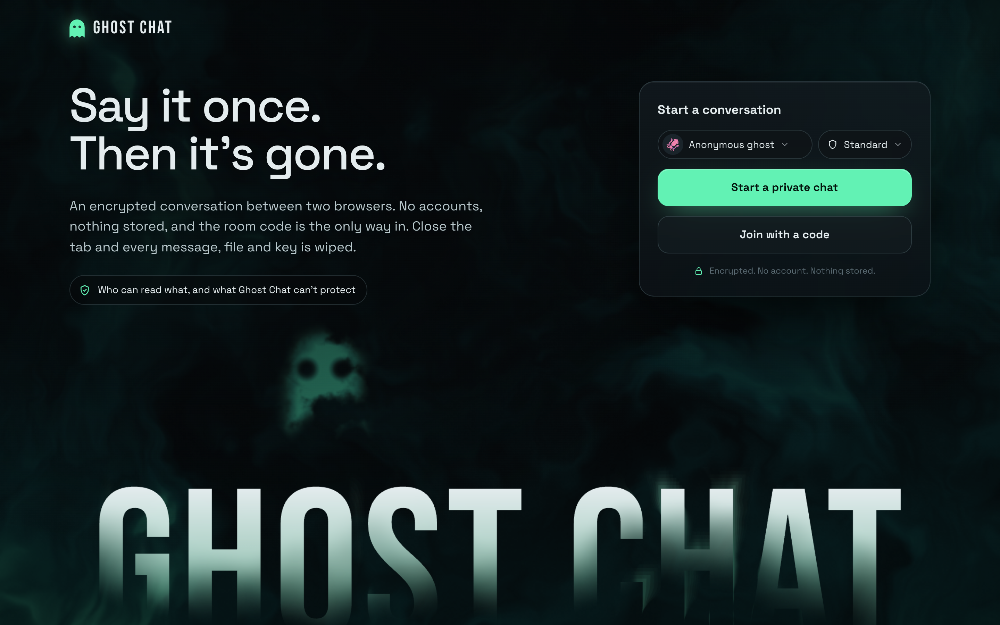
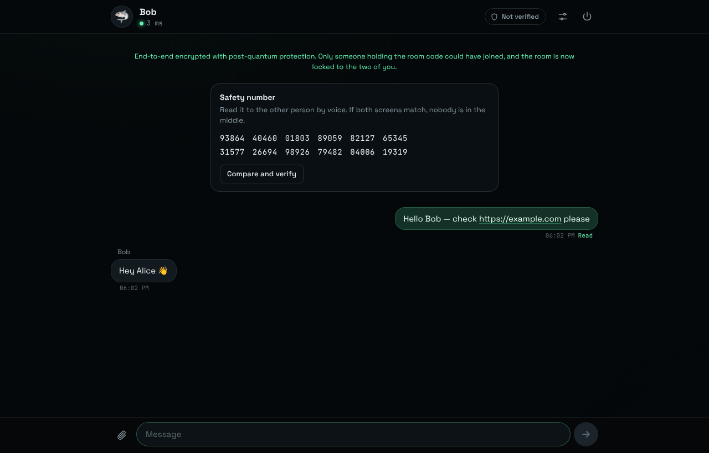
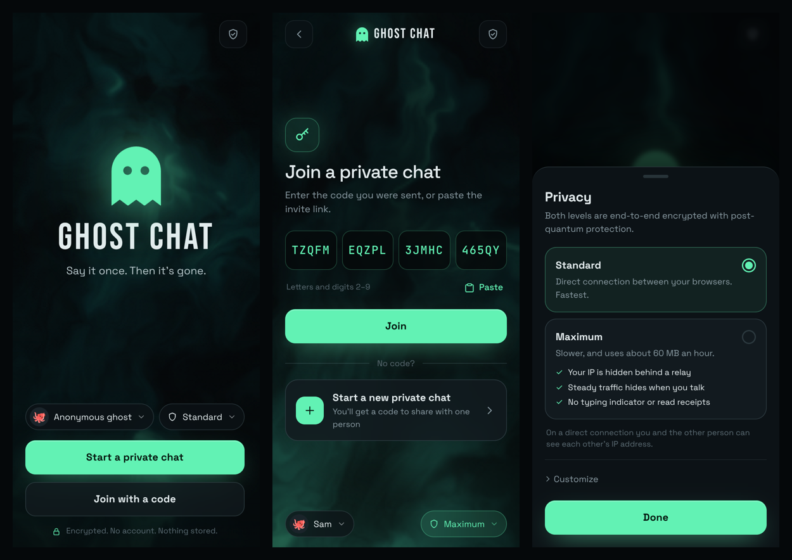
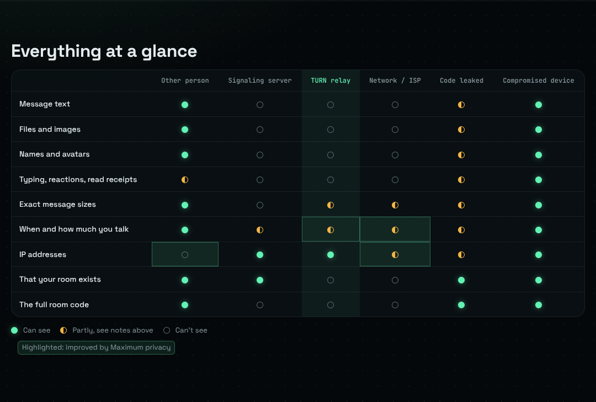

<div align="center">


# Ghost Chat

**Private, end-to-end encrypted chat between two browsers.**
Post-quantum key exchange. No accounts. Nothing stored. Close the tab and it's gone.

[](https://github.com/w3bcooki3/ghostchat/actions/workflows/ci.yml)
[](LICENSE)

[**Open Ghost Chat**](https://w3bcooki3.github.io/ghostchat/) · [Who can read what](https://w3bcooki3.github.io/ghostchat/security.html) · [Security model](SECURITY.md) · [Review history](docs/AUDIT.md)



</div>

## How it works

1. **Start a private chat.** You get a 20-character code like `TZQFM-EQZPL-3JMHC-465QY` and an invite link.
2. **Share it with one person**, over a channel you trust.
3. They open the link (or tap **Join with a code** and paste it). Your browsers prove they hold the same code, agree on fresh post-quantum keys, and connect directly. **The room then locks**: the code stops working, even for someone who has all 20 characters.
4. Optionally **compare the 60-digit safety number** by voice. If both screens match, nobody is in the middle.



## Features

**Security**
- **Hybrid post-quantum key exchange:** ECDH P-384 + ML-KEM-1024 (FIPS 203). An attacker has to break both.
- **AES-256-GCM with a new key for every message** (HMAC-SHA-384 ratchet). Tampering, replay and reordering are detected and close the connection.
- **The room code is the only way in.** The server that introduces your browsers can't join, read, or sit in the middle.
- **Room lock:** after the first join, only reconnects that prove a secret from this conversation get in.
- **Safety numbers** that stay stable across reconnects, plus a "verified" mark that survives them.
- **Maximum privacy:** one tap for relay-only routing (hides your IP from the other person), constant-rate traffic (hides when you type and send), and no typing indicator or read receipts.
- Messages padded to fixed sizes. Nothing written to disk. Strict Content-Security-Policy. No third-party CDNs. Refuses to run inside frames.
- **Panic wipe:** press <kbd>Esc</kbd> three times, or tap the button in the session sheet on phones. It destroys everything and leaves the page.

**Conversation**
- Delivered and read receipts; read receipts are optional.
- Disappearing messages (10 s to 1 h), synced between both people.
- Replies, reactions, unsend for both, remove for me.
- Typing indicator (optional).
- Files up to 100 MB, streamed in encrypted chunks with progress and cancel. Images preview inline; everything else downloads.
- Drag and drop, or paste images.
- **Automatic reconnection:** messages you send while offline are queued and delivered when the link returns.

**Motion that shows what's really happening**
- The handshake screen draws the **real handshake frames** your browser sends and receives as packets flying between two ghosts, then seals the room and decrypts the safety number into view.
- The chat header shows a live strip of the **actual ciphertext** passing each way (the first bytes of every sealed frame, exactly what the network sees), plus a count of single-use message keys.
- Incoming messages decrypt into place; disappearing messages evaporate; the home headline decrypts itself and a ghost's eyes follow your pointer.
- **QR invite:** "Show QR" on the share screen, so someone next to you can join with their camera.
- Wide screens get a real workspace: the session panel is docked on the right. Everything honours *reduce motion* and is tested with it on.

**Safety in the conversation**
- **Instant, authenticated goodbye.** Panic, closing or reloading the tab ends the session for the other person at once, instead of leaving them waiting to reconnect. The goodbye uses a secret token each side gave the other inside the encrypted channel, so nobody else can forge one; network drops still reconnect as before.
- **Nothing opens by itself.** Received photos are decoded only when you tap **View** (image decoders are a classic attack surface). Files are recognised by their bytes, not their name or declared type, and always saved as opaque bytes. Programs, scripts, HTML and SVG, including disguised ones like `invoice.pdf.exe` or an `.exe` renamed `.jpg`, ask before saving. Share uses the device's share sheet.
- **Links show where they really go** before opening, with look-alike Unicode domains shown as `xn--…` and flagged. Invisible text-direction characters are stripped, so a link can't display one address and point to another.
- A peer flooding messages can't exhaust your tab: the conversation keeps the latest 2,000.

**Connectivity**
- **Same-device link:** two tabs or windows of the same browser profile (for example two incognito windows, which share one incognito session) connect over a `BroadcastChannel`. It needs no network, STUN, relay or even the signaling server. It's only a pipe: the same room-code handshake and per-message encryption run on top, and a wrong code is refused exactly as over WebRTC. Separate browsers, separate profiles, or a normal window plus an incognito window still use WebRTC.
- **Specific failure diagnosis:** when WebRTC can't connect, the app says why (no relay reachable, strict NAT, WebRTC blocked) instead of a generic timeout, and fails as soon as ICE gives up.
- **Network check** (Privacy → Customize, or from a failed connection): local paths, public address, NAT type (detects symmetric NAT), relay reachability, and a same-page connection test.
- **Bring your own TURN relay** (Privacy → Customize): kept in memory for that tab only, never stored or sent to the other person.

### Making PC ↔ phone work on any network: relays
**Recommended: the WebSocket relay** ([`relay/ws-relay.js`](relay/ws-relay.js)), a Cloudflare Worker on the **free plan, no card needed**. When a direct connection isn't possible, both browsers talk through it over ordinary HTTPS on port 443, which passes VPNs, phone networks and strict firewalls. It carries only end-to-end-encrypted frames, and rooms on it are named by a hash of the full room code, so nobody without the code can find or block one. Deploy it (5 minutes, steps in [`relay/README.md`](relay/README.md)), set `RELAY_URL` in `js/config.js`, add it to `connect-src`, and rebuild. Joiners try direct first and bring the relay in after 2.5 s, or at once if the direct attempt fails or "Hide my IP" is on.

TURN relays (below) are the other option, and the one WebRTC itself uses.

Browsers try to connect directly first. That fails between many real networks: phones on mobile data (carrier NAT), VPNs, corporate Wi-Fi and symmetric NAT. Then the only thing that works is a **TURN relay**, a server that forwards the already-encrypted frames. It can't read them.

Ghost Chat ships with the free, shared [Open Relay](https://www.metered.ca/tools/openrelay/) project as a fallback (`PUBLIC_RELAY` in `js/config.js`), reachable over TLS on port 443 so it passes most VPNs and firewalls. It's best-effort: it's shared by everyone and has limited monthly capacity. **For a site people rely on, add your own relay. It's free at small scale and takes about ten minutes:**

- **Cloudflare (recommended, 1,000 GB/month free):** create a TURN key under *Realtime → TURN*, deploy [`relay/turn-credentials.js`](relay/turn-credentials.js) as a Worker (Cloudflare asks for a card on file for TURN, even within the free 1,000 GB) (setup steps are at the top of the file), then set `TURN_ENDPOINT` in `js/config.js` to the Worker's URL.
- **Metered (free tier):** create an app, and set `TURN_ENDPOINT` to `https://<app>.metered.live/api/v1/turn/credentials?apiKey=<key>`.

Either way, add the endpoint's origin to `connect-src` in `index.html`'s Content-Security-Policy, then rebuild (`npm run build`). The in-app **Check my network** button (Privacy → Customize) shows whether a relay is reachable from wherever you are.

### Why two windows on one computer sometimes couldn't connect
WebRTC between two windows on the same machine relies on mDNS `.local` candidates, NAT hairpinning, or a TURN relay. On many Windows setups, VPNs and symmetric-NAT networks, mDNS doesn't resolve and hairpinning isn't supported. PeerJS's free public TURN relay is also often unreachable, so every path failed and the joiner timed out after 15 seconds. Two windows of one browser profile now use the same-device link. For real conversations across such networks, configure a TURN relay. A self-hosted [coturn](https://github.com/coturn/coturn) works, or any TURN provider; set it in `js/config.js` (`ICE_SERVERS`) or in the app.

**Phones**
- An app-style launcher: the brand glows in the fog, with **Start a private chat** and **Join with a code** in thumb reach. Your name and privacy level are chips that open bottom sheets.
- **Join with a code** opens a dedicated code pad: four boxes that accept a pasted code or a whole invite link, a Paste button, and look-alike warnings (no 0, 1, I or O). Invite links open it already filled in, so joining is one tap. The phone's back button returns home.
- Bottom sheets for session settings and message actions; swipe a message right to reply, long-press for actions.
- Native share sheet for invites, a keyboard-aware composer, safe-area insets, and 44-pixel touch targets throughout.



## Who can read what

Ghost Chat protects **content** completely and narrows **metadata** where a web app can. The [interactive page](security.html) lets you pick any observer and see a sample conversation through their eyes. Here is the summary, with **Maximum privacy** on (highlighted cells are what it changes):



Some things no web app can fix:
- **A compromised device:** malware sees your screen.
- **The other person:** they can keep a copy of anything.
- **Metadata at the signaling server:** it sees your IP address and when you connect, unless you [run your own](#run-your-own-servers) and use a VPN or Tor.
- **A code that leaks before your peer joins:** whoever has it could get in first. The safety number exposes that.
- **Other pages on the same origin, in the same browser profile,** can see the same-device link's *ciphertext* and can drop the link (it then reconnects). They can't read or forge messages. Script running on Ghost Chat's own origin is already a compromise, so this changes nothing in practice.

### Is it "military grade"?

Nobody certifies apps as military grade, so the phrase means nothing on its own. Ghost Chat uses the **same algorithms and key sizes as the NSA's CNSA 2.0 suite**: AES-256, ML-KEM-1024 and SHA-384, plus P-384 during the transition period. That's a statement about algorithm choice, not a certification. It isn't FIPS-validated or independently audited, and a website isn't a classified environment. Details are in [SECURITY.md](SECURITY.md).

## Deploy to GitHub Pages

1. Push this repository to GitHub.
2. Go to **Settings → Pages → Build and deployment**, and set **Source** to **GitHub Actions**.
3. Push to `main`. The [CI workflow](.github/workflows/ci.yml) runs the unit tests and the real-browser end-to-end suite, and checks that the committed single-file build matches the source. **It deploys only if all of that passes.**

Your chat is then live at `https://<user>.github.io/<repo>/`, and the single file is at `/ghostchat.html`.

GitHub Pages can't set HTTP headers. The CSP still applies through a `<meta>` tag, and the app refuses to run inside frames. On Netlify or Cloudflare Pages, [`_headers`](_headers) adds the full header set.

## Other ways to run it

**One file.** [`dist/ghostchat.html`](dist/ghostchat.html) has everything inlined: fonts, styles, PeerJS, ML-KEM and the app, with a hash-based CSP. Open it from disk or host it anywhere.

**Verify it first:**
```bash
sha256sum ghostchat.html     # must match dist/SHA256SUMS from the commit you trust
```
The build is deterministic, so you can also rebuild it yourself and compare: `node tools/build.mjs`.

**Fully offline, on one machine or a LAN** (for development):
```bash
npm install
npm run serve:local          # signaling on :9000, app on http://127.0.0.1:8090
```

### Run your own servers
The default introduction server is the public `0.peerjs.com`, and the default relay is the shared Open Relay project (see [relays](#making-pc--phone-work-on-any-network-relays)). For real metadata privacy, run your own:
```bash
npx peerjs --port 9000       # signaling
# plus a TURN server such as coturn, for relay-only mode
```
Then edit [`js/config.js`](js/config.js) (`SIGNALING`, `TURN_ENDPOINT` or `ICE_SERVERS`, and `PUBLIC_RELAY = false`) and the `connect-src` entry of the CSP in `index.html`.

## Development

```bash
npm install
npm test               # unit tests (Node): protocol, plus relay credentials, ICE sanitizing, TURN input
npm run test:e2e       # both browser suites: the original scenarios + connectivity/motion/expiry
npm run build          # → dist/ghostchat.html, dist/security.html, dist/SHA256SUMS (commit all three)
npm run serve:local    # app on http://127.0.0.1:8090 with its own local signaling server on :9000
```

The end-to-end suite covers:
- two separate browsers over WebRTC, with an HTML-injection check;
- two windows of one profile with **no signaling server** (the same-device link), and with it up;
- wrong codes refused over both transports, and a locked room refusing a correct code;
- a dropped link resuming with the safety number kept;
- relay-only with no relay failing with a specific diagnosis, plus the network check;
- byte-exact file transfer over WebRTC, the same-device link and the WebSocket relay, and 200-message ordering;
- two browsers with no signaling and no direct path connecting through the relay; wrong codes finding nothing there; "Hide my IP" over the relay;
- panic and closing the tab ending the session for the other person at once, and a forged goodbye being ignored;
- `index.html` opened from disk explaining itself, and `dist/ghostchat.html` working from disk.

> **Opening `index.html` by double-clicking it won't work:** browsers block module scripts on `file://`. The page now says so. Use `dist/ghostchat.html` (one self-contained file) or `npm run serve`.

### Project layout
```
index.html             app markup + Content-Security-Policy
security.html          "Who can read your conversation?" (css/security.css, js/security.js)
css/app.css            styles (desktop + phone layer)
js/protocol.js         crypto protocol v3: codes, hybrid handshake, lock/resume, ratchet, padding (no DOM)
js/session.js          session engine: transports, handshake, reconnection, delivery, goodbye, files (no DOM)
js/relay.js            WebSocket relay transport (a byte pipe; no crypto of its own)
js/local.js            same-device transport over BroadcastChannel (a byte pipe; no crypto of its own)
js/netcheck.js         network check: candidates, NAT type, relay reachability, loopback
js/ice.js              which STUN/TURN servers to use (your endpoint, fixed list, public relay)
relay/ws-relay.js      WebSocket relay: Cloudflare Worker + Durable Object (free plan); see relay/README.md
relay/turn-credentials.js  optional TURN credential Worker
js/app.js              interface controller (screens, chat, settings), built on js/ui/*
js/ui/sanitize.js      input hygiene: names, text, links, file risk and safe file names (pure, unit-tested)
js/ui/dom.js           DOM helpers, toast, confirmation dialog
js/ui/media.js         received files: view-on-demand, save as opaque bytes, risk prompts, share
js/ui/handshake.js     the connecting screen's handshake animation, driven by real frames
js/fog.js              home-screen WebGL atmosphere
js/fx.js               motion effects (decrypt text, eyes, ciphertext strip) and the QR renderer
js/config.js           signaling, ICE servers, limits
vendor/                PeerJS 1.5.5, ML-KEM-1024 from noble-post-quantum 0.7.1, uqr 0.1.2 QR encoder (all MIT)
fonts/                 Space Grotesk, JetBrains Mono, Bebas Neue (SIL OFL)
tests/                 unit tests, end-to-end tests, local servers
tools/build.mjs        deterministic single-file build
.github/workflows/     CI + GitHub Pages deployment
```

## Status

Ghost Chat has had two rounds of internal security review, recorded in [docs/AUDIT.md](docs/AUDIT.md), but **no independent audit**. It's a good tool for private conversations with people you trust. For high-risk situations, use Signal.

Found a security problem? Please open a **private security advisory** on this repository rather than a public issue.

## License

MIT. PeerJS and noble-post-quantum are MIT; the fonts are under the SIL Open Font License (see `fonts/`).
